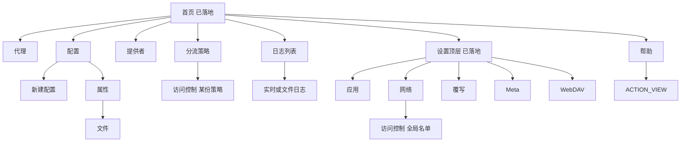
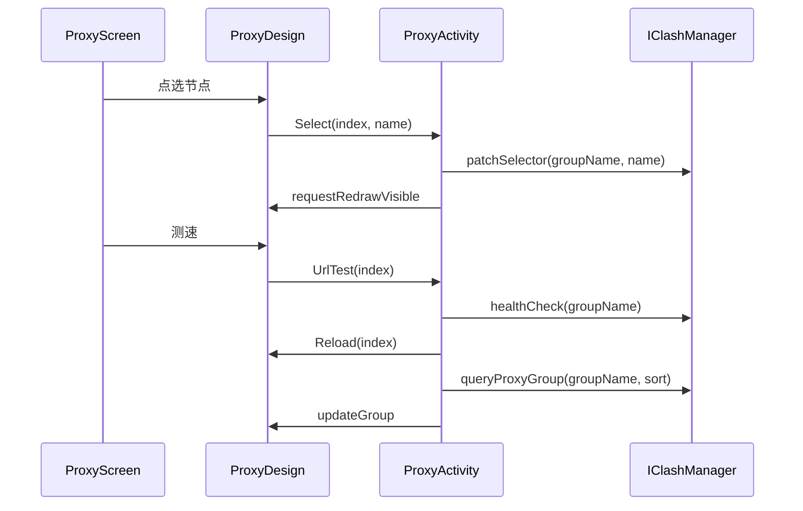

# 其余屏幕的 iOS 分组交互方案

> 作者：待定
> 制定日期：2026-10-15
> 修订：2026-10-16，按并行审查改过落点、重建和现有文案
> 状态：已落地

## 概述

首页和设置顶层已经是 Jetpack Compose，视觉按 Apple HIG 做在 `design/src/main/java/com/github/kr328/clash/design/ios/`。代理、配置、提供者、日志、访问控制、分流策略，以及应用、网络、覆写、Meta、WebDAV 的具体设置，仍是 XML、RecyclerView 或 `preferenceScreen`。本方案只替换这些用户会看到的屏幕，让它们使用同一套分组列表、44dp 点按、按压闪一下（`indication = null`）和 `ClashMetaXTheme`。

交互按手机上的任务频率来排，不把 [Clash Verge Rev](https://github.com/clash-verge-rev/clash-verge-rev) 的桌面页面缩小。可迁移的是信息架构：一次看一个代理组、配置卡片上的更新和更多、日志的过滤和搜索、设置按分组。不迁移侧边栏、窗口装饰、系统代理和 TUN 两张卡片、首页卡片显隐、链式代理、配置拖拽排序。Android 仍只有一条 VPN。连接按钮留在首页，本方案不设计第二套开关，停止隧道继续不确认。

Activity 继续拥有请求和业务。`*Design` 持有界面状态，通过现有的无界 `requests` 通道把请求交给 Activity。Composable 不调用 `IClashManager`、`IProfileManager`、`PackageManager` 或 WebDAV。

## 背景与动机

现在的分叉点记在 [界面](docs/systems/ui/INDEX.md) 和 [ADR-002](dev/decisions/002-compose-ios-home.md)。首页已经把模式、速率和当前节点放在连接下面。用户点进代理、配置或设置子页时，仍回到 Material 列表、ViewPager 标签和弹出菜单，两套语言接在一起。

和任务频率不匹配的地方：

- `ProxyDesign` 用 `ViewPager2` 加 `TabLayoutMediator` 把每个代理组做成一页，并用 `UiStore.proxyLine`（1、2 或 3 列）画网格。订阅里常见十几个组、一个 Selector 里上百个节点，标签栏和网格都不是最短路径。菜单 `menu_proxy.xml` 里还有一套模式，和首页的三个按钮重复，两边都写 `Clash.OverrideSlot.Session`。
- `ProfilesDesign` 的主任务是设为当前，次任务收在底部表 `dialog_profiles_menu.xml`。结构可以留，容器要换成分组行。
- 访问控制把搜索做成全屏对话框，排序、全选和导入收在 `PopupMenu`。点选规则本身不能改，入口可以缩短。
- 设置子页是 `preferenceScreen` 的分类和行。数据绑定方式是对的（直接写属性，多数情况不发 `requests`），视觉和顶层设置不一致。覆写页和 Meta 页字段多，但不能因此改成另一套存储。

Verge 的导航是 `src/pages/_navigation-meta.ts` 里的 home、proxies、profiles、connections、rules、logs、unlock、settings。本仓库的 `IClashManager` 和 `core/.../bridge/Bridge.kt` 没有连接列表、规则全文、关闭全部连接或配置重排。这些页本期不做。内核 Go 路由里即使有对应 HTTP 接口，也没有接到界面进程，本方案不为此新增 Binder。

## 目标与非目标

### 目标

- 下列屏幕的根视图改为 `ComposeView`，外观使用已有的 `IosColors`、`IosType`、分组圆角和 44dp 最小高度。
- 每个屏幕写清主操作、次操作、默认折叠项，以及空、加载、错误、长列表。
- 现有 `*Design.Request` 的成员和处理分支保持可识别。确认框放在 Activity 调用的 Design 挂起函数里，与 `LogsActivity` 调用 `requestDeleteAll()` 的方式相同。
- 破坏性动作有确认。停止 VPN 是例外，首页已经决定不确认，本方案不改 `MainActivity` 的 `ToggleStatus`。
- 每个屏幕可以单独审查、单独合并、单独回退到原来的 Design，不引入 feature flag。

### 非目标

- 不改首页的信息架构，不改设置顶层的两个分组，不改 `applicationId`、`clash://`、`clashmeta://` 和外部控制 action。
- 不把 VPN、配置提交、代理选择、访问控制持久化或 WebDAV 搬进 Composable。
- 不改访问控制的点选语义、保存目标和重载条件。规则仍以 [访问控制](docs/systems/access-control/INDEX.md) 为准。
- 不改配置的导入、更新、提交和文件 Provider 的可见性规则。见 [配置](docs/systems/profiles/INDEX.md)。
- 不改 WebDAV 的合并、局域网探测和默认常量。见 [WebDAV](docs/systems/webdav/INDEX.md)。
- 不新增 `IClashManager` 方法。`Clash.healthCheckAll()` 没有进 Binder，本期不暴露，界面只对当前组调用已有的 `healthCheck(group)`。
- 不做连接列表、规则全文、链式代理、配置拖拽排序、Verge 的 Unlock、首页卡片显隐、系统代理和 TUN 双卡片。
- 不引入 `compose-cupertino`、SF Symbols 或 Material 3。继续 `androidx.compose.material`。Compose 依赖只留在 `design`。`minSdk` 仍是 21。
- 不改根 `README.md`。关于页不新开 Activity。

## 方案

### 已经落地、本方案遵守的约束

| 约束 | 落点 |
|:-----|:-----|
| 显示名 ClashMetaX | `application_name` / `launch_name`。内核名仍是 Clash Meta Core |
| 暗色 | `ClashMetaXTheme` 读 `UiStore.darkMode`，不是只看 `configuration.uiMode` |
| insets | `Design` 的像素监听写入 `Insets`，Compose 用 `LocalDensity.toDp()`。禁止再叠 `WindowInsets.safeDrawing` |
| 按压 | `MutableInteractionSource`，背景用 `IosColors.pressed`，`indication = null` |
| 图标 | 已有的 `androidx.compose.material.icons`，例如返回和行尾箭头 |
| 请求 | `Design.requests` 是 `Channel(Channel.UNLIMITED)`。Activity 在 `select` 里 `onReceive` |
| Toast | `Design.showToast` 在 `root` 上弹 `Snackbar`。根必须仍是 `View`（`ComposeView`），这样现有 toast 和带 action 的 toast 不用改 |
| 业务边界 | 与 `MainDesign` 相同：Composable 调回调，Design `trySend`，Activity 调 `withClash` / `withProfile` |

新的 Compose 屏幕在自己的 `init` 里再次 `setOnInsertsChangedListener`，同时写 `surface.insets` 和 Compose 的 `Insets` 状态。`Design` 基类和子类各设一次监听，后一次生效。这是 `MainDesign` 和 `SettingsDesign` 已经在用的写法。

推入的屏幕用已经落地的 `IosNavBar`（44dp、居中标题、左侧返回），不在返回栏下面再放 34sp 大标题。大标题只留在首页。这些页面都是从首页或设置推入的，和 `SettingsScreen` 同级。再加大标题会把搜索和主操作挤出首屏。

长列表不用现在的 `IosInsetGroup`。那个组件是 `Column`，适合设置里十几行，不适合几百个节点或应用。长列表用 `LazyColumn`，左右 16dp 内边距，行高至少 44dp，分隔线从 16dp 开始，颜色用 `IosColors.separator`。短设置页继续用分组圆角容器。



### 共享控件

放在 `design/.../design/ios/`，供后面的屏幕 PR 使用。首页已经在用的公开控件是 `IosInsetGroup`、`IosButton`、`IosNavBar`、`IosModePicker`，以及数据类 `IosDetail`。`IosDetailRow` 是 `IosComponents.kt` 里的私有 composable，首页和设置都不直接调用它，扩展时不要把它改成公开 API。需要扩展的是 `IosDetail`：加上可选副标题、选中标记和行尾动作，新字段都有默认值，使 `HomeScreen` 和 `SettingsScreen` 的现有调用布局不变。不另起一套颜色。

| 控件 | 用途 |
|:-----|:-----|
| `IosScreenScaffold` | 背景、insets 转 dp、`IosNavBar`、可选导航栏末端动作。内容区自己决定滚动还是懒加载 |
| `IosSearchField` | 单行搜索。空关键字表示不过滤。输入在 Design 里以约 200ms 合并，和现在访问控制搜索的 `delay(200)` 同级 |
| `IosDetail` 的新字段 | 可选副标题、选中标记、行尾文字按钮。默认空，不改变现有两行结构。长列表可以复用同一个行实现，但不必把私有的 `IosDetailRow` 公开 |
| `IosSwitchRow` | 标题、摘要、开关。开关本身至少 44dp 高。按压仍是背景变化，不是 ripple |
| `IosOptionSheet` | 从底部弹出的单选列表，替代 `ListPopupWindow`。选项不超过一屏时不搜索 |
| `IosActionSheet` | 一行主任务之外的多个动作，替代 `AppBottomSheetDialog`。破坏性项用 `IosColors.red`，放在最后 |
| `IosConfirmDialog` | 标题、说明、取消、确认。确认按钮在破坏性场景用红色文字。返回 `Boolean` |
| `IosEmptyState` | 一句说明，可选一个主按钮 |
| `IosProgressRow` | 行内不确定进度，用于正在更新的配置或提供者 |

行尾动作必须是看得见的按钮或动作表，不能只放在左滑里。左滑在没有辅助功能提示时发现成本高，而且配置、文件都有两个以上的次操作。左滑不作为本期入口。

单行文本继续走 `requestModelTextInput`，校验函数保持 `ValidatorNotBlank`、`ValidatorHttpUrl`、`ValidatorAutoUpdateInterval`、`ValidatorAgeSecretKey`、`ValidatorFileName` 和 `NullableTextAdapter.Port`。列表和映射继续走现有的 `requestEditableListOverlay`。这些对话框本期不重写。重写会把已经测过的「重置得到 null、取消写回原值」做丢。屏幕本身换成分组列表，对话框仍是短暂编辑器。

### 代理

**任务和入口。** 主任务是在当前策略组里选一个节点。入口是首页「正在使用」里的代理行，以及当前节点行。核心没在跑时，首页代理行不可点，本屏不会被打开。提供者仍从首页进入，代理屏不再放第二个人口。更新提供者的频率远低于选节点。

**信息层级。**

1. 导航栏标题是现有的代理标题。末端是测速。组非空且不在测速时可以点；测速中换成行内进度，不能再点。测速不再使用会在滚到底部时隐藏的浮动按钮。
2. 置顶一行：当前组名、`ProxyGroup.type`、该组的 `now`。只有一个组时这行不可点。多于一个组时点开可搜索的组列表。用户在这张表里点中一组之后，才把组名写入 `UiStore.proxyLastGroup`。不用 `ViewPager2`，也不用横向标签。组数由配置决定，经常超过一屏。
3. 搜索框过滤当前组的 `Proxy.name` 和 `Proxy.title`，忽略大小写。清空后恢复全表。搜索不改变选择。
4. 节点一行一个，文字和 `ProxyViewState.update` 一致，不另做一套标题规则。非组：主文字是 `proxy.title`，副文字是 `proxy.subtitle`，没有「`title` 为空就改用 `name`」。组：主文字是 `proxy.name`。该组自己的 `queryProxyGroup` 还没返回时，副文字只是 `proxy.type`。返回之后，若 `link.now` 非空，副文字是 `"%s(%s)".format(proxy.type, link.now)`；`link.now` 为空时沿用现在的 `"%s(*)".format(proxy.type)`。不要把 `ProxyState` 构造时的 `"?"` 显示成嵌套组的当前节点。今天 `ProxyActivity` 会给每个组名预先放一个 `ProxyState("?")`，旧视图因此会画出 `Type(?)`。懒加载之后，未查询的组不算已知，副文字停在类型上。
5. `delay` 在 `0..Short.MAX_VALUE` 时显示毫秒，否则不显示数字，这和 `ProxyViewState` 一致。选中标记比较的是 `proxy.name == parent.now`，不是 `title`。
6. 点击不打开另一组页面。行能不能点只看父组是不是 `Selector`，也就是 `updateGroup` 现在的 `selectable`（`group.type == "Selector"`）。`isGroup` 本身不禁止点击。父组是 `Selector` 时，点组行仍然 `patchSelector`。
7. 溢出菜单只留排序（`ProxySort.Default`、`Title`、`Delay`）和「排除不可选」。`menu_proxy.xml` 里的整个模式子菜单都去掉，包括「不修改」、直连、全局、规则。列数子菜单（单列、双列、多列）也去掉。`UiStore.proxyLine` 的键留着，新界面不读它，避免做偏好迁移。

`proxy.subtitle` 不是界面再拼出来的类型字符串。`convertProxies` 默认把 `title` 设成节点名、把 `subtitle` 设成 `Type().String()`。配置里的 `ui-subtitle-pattern` 仍由 `native/config/load.go` 交给 `app.ApplySubtitlePattern`，再在 `convertProxies` 里对非组节点做匹配：匹配片段进 `Subtitle`，名字的其余部分进 `Title`。这条正则留在核心里，Compose 不重写、不关闭。

**组的初始位置。** `ProxyActivity` 今天用 `uiStore.proxyLastGroup` 决定 `ViewPager` 的初始页，并在 `onPageSelected` 里把当前页写回这个偏好。另外，首页 `MainActivity.queryCurrentNode` 已经按模式选出一个组，但只把 `now` 交给首页。点当前节点时，把这一次选出的组名用应用内部 extra 传给 `ProxyActivity`。extra 不进 `Intents` 的导出动作，不进 `clash://`。这不是用户自选的「当前组」，启发式仍只在 `MainActivity`。

落点顺序：

1. extra 非空，并且这个名字在本次 `queryProxyGroupNames` 的结果里：打开这个下标。
2. 否则 `proxyLastGroup` 在结果里：打开它。
3. 否则若名单非空，打开下标 0。
4. 名单为空时不选下标，不发 `Reload`。只显示空态，并隐藏测速和搜索。Direct 模式，以及全部组被隐藏时，`queryProxyGroupNames` 都是空列表。现在的 `ReloadAll` 只遍历 `names.indices`，空列表不会发请求。新界面不能对下标 0 发 `Reload`，否则会在 `names[0]` 越界。

extra 缺失、空串，或不在组名列表里，都走第 2 步。不要用这个名字去调 `queryProxyGroup`。`Clash.queryGroup` 对未知名字返回 `ProxyGroup("Unknown", emptyList(), "")`，界面会把一个假的空组画出来。

应用 extra 或恢复 `proxyLastGroup` 都不写 `proxyLastGroup`。只有用户在组列表里点选时才写。否则从当前节点进来会把启发式组记成「上次浏览的组」，下一次从代理行进来（extra 为 null）就不再是用户上次自己选的组。旧的 `onPageSelected` 一打开就写入，新界面不要照做。

extra 只决定这一次打开的初始组。用户在组列表里点选之后，改写或清掉本次 Intent 里的 extra。`ProxyActivity` 的 `configChanges` 只有 `uiMode`，其它配置变化会重建；extra 还在时会再次套用启发式组，把刚选的组盖掉。`ReLaunch` 和组名变化后的 `startActivity` 要带上当前正在显示的组名，这次仍然不写 `proxyLastGroup`。不要把这两条重启写成和现在完全一样。现在的空 Intent 能留在当前组，是因为 `onPageSelected` 已经把组名写进 `proxyLastGroup`。新界面不再一打开就写这个偏好，空 Intent 会掉回旧的 `proxyLastGroup` 或第一组。

**状态。**

- 加载：组名已经拿到、当前组的 `queryProxyGroup` 还没返回时，列表区显示进度，不显示空态。
- 空：`queryProxyGroupNames` 得到空列表时，沿用现在的空页含义，隐藏测速和搜索，并且不发 `Reload`。
- 错误：`withClash` 对 `DeadObjectException` 会重试。其他异常继续抛出，不新增错误通道，也不把节点名写进新的日志。
- 长列表：只把当前组放进 `LazyColumn`。一个 Selector 可以有几十到几百个节点，`ProxyGroup` 的 Parcel 已经按 50 个一块切片，界面不再把所有组的节点同时挂上。

**加载范围。** 现在有两处会把所有组拉进来。菜单改列数或排序会发 `ReloadAll`。`ProxyActivity.main` 还在 `setContentDesign` 之后、进入 `select` 之前无条件 `design.requests.send(ReloadAll)`。`ReloadAll` 再为每个下标发 `Reload`，并用许可数 10 的信号量并发 `queryProxyGroup`。新界面一次只显示一个组，所以这两处都不能留：Activity 删掉启动时那一次 `ReloadAll`，新屏幕自己也不发送 `ReloadAll`。打开、切换组、测速结束和排序，都只 `Reload` 当前下标。`proxyExcludeNotSelectable` 会改变组名列表，仍发 `ReLaunch`，由 `ProxyActivity` 重新 `startActivity` 并 `finish()`。`ProfileLoaded` 后组名变化也仍是重新打开自己。`when` 里的 `ReloadAll` 分支可以留着，这样回退到旧 Design 时旧菜单还能展开成逐组 `Reload`。回退必须使用同一个 PR 的旧 Activity，因为启动时的 `send(ReloadAll)` 也在这次修改里。

**Request。** 不新增成员。

| 请求 | 谁发出 | Activity 现有行为 | 新界面 |
|:-----|:-------|:------------------|:-------|
| `ReloadAll` | 旧菜单，以及今天启动后的那一次 `send` | 为每个下标再发 `Reload` | 启动路径和新屏幕都不发送。处理分支留着，只给回退后的旧 Design 用 |
| `ReLaunch` | 排除不可选；组名列表变化 | 用只有组件名的 Intent 重启本 Activity | 重启时带上当前正在显示的组名，并且不写 `proxyLastGroup`。排序不走这里 |
| `Reload(index)` | 打开、切换组、测速结束、排序 | 信号量内 `queryProxyGroup(name, uiStore.proxySort)` | 只对可见下标发送 |
| `Select(index, name)` | 点节点 | `patchSelector`，然后把本地 `now` 设成该名字 | 仅当父组 `type == "Selector"` 时行可点，组行也一样。返回值仍忽略，不新增成功或失败 toast |
| `UrlTest(index)` | 测速 | `healthCheck(names[index])` 再 `Reload` | 同左，按钮改到导航栏 |
| `PatchMode` | 旧模式子菜单，含「不修改」 | toast `mode_switch_tips`，写 Session override | 新界面不发出，包括 `PatchMode(null)`。模式只在首页 |

`updateGroup` 的 `selectable` 仍是 `group.type == "Selector"`。URLTest、Fallback、LoadBalance 等组展示 `now`，行不可点，测速仍可用。Script 模式不在这一屏显示，首页已经规定三个模式按钮都不选中。

**不改的规则。** 选择写入内核的 selector，不写配置文件。模式不在这一屏修改，整段模式子菜单都不再写 `OverrideSlot.Session`。不调用 `healthCheckAll()`。不新增按延迟阈值上色的规则，因为现在的 `ProxyView` 也没有给延迟分色。`ui-subtitle-pattern` 仍由核心填充 `title` 和 `subtitle`。嵌套组的 `now` 不删，只是未加载时不显示占位问号。



### 提供者

**任务和入口。** 主任务是更新一个外部资源。首页只在隧道运行且 `queryProviders()` 非空时显示这一行。`ProvidersActivity` 在 `ProfileLoaded` 后若列表变化，仍重新打开自己。

**信息层级。** 按 `Provider.Type` 分成两组：`Proxy`、`Rule`。分组只改变分段，不改行文案。组内顺序保持 `Provider.compareTo`，也就是先类型后名称，Activity 已经 `sorted()`。每行是名称、`format_provider_type` 的整句（类型和载体拼在一起，例如代理(HTTP)），以及 `updatedAt` 的经过时间。不要只画 `vehicleType`。`Compatible` 已在查询里被跳过，不会出现。经过时间仍由前台每分钟 `updateElapsed()` 推动。`VehicleType.Inline` 没有更新按钮，也不显示经过时间。其余行的行尾是「更新」。导航栏末端是「全部更新」。不要照抄 `ProvidersDesign.requestUpdateAll`：它先 `filter { !it.updating }` 再 `forEachIndexed`，发出来的下标是过滤后的位置，不是 `states` 的下标，`notifyChanged` / `notifyUpdated` 会改到另一行。它还会在判断 `vehicleType` 之前把 Inline 的 `updating` 设为 true，又不发送 `Update`，这个标记永远清不掉。新循环按原始列表走：已经在更新的跳过；Inline 跳过，并且不要把 `updating` 设为 true；其余用原始下标发 `Update`，再把该行标成更新中。仍然是多次 `Update`，不新增「全部更新」请求。

**状态。** 打开时列表已经在构造函数里拿到，没有单独的加载态。空列表理论上到不了这一屏，因为首页用 `isNotEmpty()` 决定入口；若仍为空，显示空态，不显示全部更新。失败保持 `showExceptionToast(format_update_provider_failure)`，然后 `notifyUpdated` 只清掉该行的更新中状态。成功走 `notifyChanged`，把 `updatedAt` 设为当前时间。不要在新日志里记提供者名称。

**Request。** 只有 `Update(index, provider)`。Activity 调用 `updateProvider(type, name)`。不新增全部更新请求，全部更新仍然是多次 `Update`。

**不改的规则。** Inline 不能更新。发给 Activity 的索引是构造时那份列表的原始下标，不是过滤后的位置。列表内容变化靠重启 Activity，不在原地做 diff。单行更新和失败 toast 的调用不变。

### 配置

**任务和入口。** 主任务是把一份已导入的配置设为当前。入口是首页「正在使用」的配置行。次任务是更新、编辑、复制、分享订阅二维码、删除，以及新建。

**信息层级。**

- 导航栏末端：存在「已导入且类型不是 `File`」的配置时显示全部更新，否则隐藏。这是 `patchProfiles` 里现在的 `updateView` 可见性。更新过程中按钮进入进度，结束后 `finishUpdateAll()`。
- 列表第一行视觉权重最高的是「新建」，固定在导航栏末端的另一侧或列表上方的分组按钮。新建的频率低于切换当前配置，所以不做成浮动按钮盖住列表。推荐放在导航栏，全部更新在其旁边。列表本身从第一条配置开始。
- 每张卡片一行：名称是主文字。副文字是类型；`pending` 时用现在的未保存文案。当前配置显示选中标记，整行点击发出 `Active`，不是只点那个标记。
- 流量、总量、到期日、用量条和更新经过时间留在副文字和脚注里，条件按 `adapter_profile.xml` 的绑定，不按字段名猜测。已用流量的文字是 `toBytesString(download + upload)`。这一行在 `download < 2` 时隐藏，也就是 `download >= 2` 才出现。`total > 1` 时在已用后面加 `/` 和总量；否则只写已用，不留单独的斜杠。用量条是另一条可见性：`total < 2` 时隐藏，也就是 `total >= 2` 才出现。到期日在 `expire == 0` 时隐藏，`expire > 0` 时用现有的日期格式。用量条的进度沿用现有绑定，不是普通的 used/total 百分比：`max` 是 1000，`total > 1` 时进度是整数除法 `(download + upload) / (total / 1000)`。`total` 在 2 到 999 时除数是 0，现有绑定会抛算术异常。新界面在 `total / 1000 == 0` 时不画这条，这是为了避开崩溃而标出的行为变化；其余比例与绑定相同。不默认折成另一页。
- 行尾是「更多」，打开动作表，条目和 `dialog_profiles_menu.xml` 一致。更新只在已导入且不是 `File` 时出现。复制只在已导入时出现。分享二维码只在 `isShareableSubscriptionUrl(source)` 为真时出现，也就是 `ValidatorHttpUrl`。删除始终出现，用红色，放在最后。

**状态。**

- 加载：进入前台或 `ProfileChanged` 时 `queryAll()`。列表还没返回前保持上一份数据，首进为空列表加进度，不用空态冒充加载。
- 空：没有任何配置时，空态的主按钮是新建。
- 错误：更新失败仍走 `ProfilesActivity.onProfileUpdateFailed`，toast 带配置名和原因，action 打开对应的 `PropertiesActivity`。成功 toast 同样带名称。这些 toast 是给用户看的，不写到 `Log`。
- 长列表：配置数量通常是个位数到几十。仍用 `LazyColumn`，避免以后订阅很多时一次铺开。

**Request。** 不新增。

| 请求 | 行为，保持不变 |
|:-----|:---------------|
| `Create` | 打开 `NewProfileActivity` |
| `UpdateAll` | 对已导入且类型不是 `File` 的配置调用 `update` |
| `Update` | `update(uuid)` |
| `Delete` | 先经 `IosConfirmDialog` 确认，再 `delete(uuid)`。现在底部表点删除没有第二步确认，这是本方案新增的确认，业务调用不变 |
| `Edit` | 打开带 UUID 的 `PropertiesActivity` |
| `Active` | 已导入则 `setActive`；未导入则 `requestSave`，toast `active_unsaved_tips`，action 发 `Edit` |
| `Duplicate` | `clone` 后打开新 UUID 的属性页 |

分享二维码不走 `requests`。它现在就是 `ProfilesDesign.showSubscriptionQr`，留在 Design 里。二维码内容是订阅 URL，不写入日志。

前台每分钟 `updateElapsed()` 保持。

**不改的规则。** 没有重排接口，不做拖拽排序。未导入的配置不能直接设为当前。`File` 不参与单次更新和全部更新。

### 新建配置

**任务和入口。** 从配置页 `Create` 进入。主任务是选一种来源并创建，然后打开属性页。

**信息层级。** 第一个分组是文件、URL、二维码，各一行，副文字用现有的 `import_from_*`。第二个分组只在 `queryProfileProviders()` 找到 `ACTION_PROVIDE_URL` 的外部 Activity 时出现。外部行的主文字、副文字和图标来自那个 Activity。行尾提供「详情」，发 `OpenDetail`，Activity 打开该包的应用详情设置。点行本身发 `Create` 或 `LaunchScanner`。

**状态。** 现在的 `NewProfileActivity` 先 `await queryProfileProviders()`，再 `patchProviders`，然后才 `setContentDesign`。窗口在查询期间还不存在，所以 Compose 树里的全屏进度用户看不到。新顺序是先 `setContentDesign`：文件、URL、二维码三行立刻出现，不用空态或全屏进度替换它们。包管理器查询进行时，只在第二个分组里显示进度。查询结束后，没有外部 Activity 就不显示第二个分组，也不用空态。二维码取消不做任何事。没有相机权限和扫描失败继续 `showExceptionToast`，字符串仍是 `import_from_qr_no_permission` 和 `import_from_qr_exception`，Snackbar 上仍有「详情」。不要收成不带详情的普通 toast。成功则 `create(Url, 新配置名, 扫到的字符串)` 并打开属性页。属性页 `RESULT_OK` 时新建页 `finish()`。

**Request。** `Create`、`OpenDetail`、`LaunchScanner`。QR 不走 `Create`，这是 `NewProfileDesign.requestCreate` 已经分开的。文件和 URL 用 `Profile.Type.File` 和 `Url`，名称是 `R.string.new_profile`，源为空。外部提供者用返回的 URI 和可选名称，类型是 `External`。

**不改的规则。** 不在新建页编辑名称、间隔或密钥。那些在属性页。

### 属性

**任务和入口。** 编辑一份配置的名称、来源、自动更新间隔和 age 密钥，然后保存。入口是配置页的编辑、复制之后、新建之后，以及 `ExternalControlActivity` 导入链接之后。

**信息层级。** 导航栏末端是保存，处理中换成不确定进度，保存不可点。页顶保留 `tips_properties`，经 `getHtml` 解析，正文带 `<strong>`，不是纯文本。它是分组外的脚注，不做成可点行。

分组「配置」：

- 名称。点按打开现有文本框，`ValidatorNotBlank`。
- 来源。`File` 的摘要是 `R.string.unavailable`（不可用），不可点。`External` 的摘要仍是 `profile.source`，不可进入编辑；`inputUrl()` 现在一进来就 return。可编辑来源才走 `ValidatorHttpUrl`。两种都不可点可以做，摘要不能收成同一种。
- 自动更新。`File` 的摘要同样是 `unavailable`，不可点。可编辑时显示 `format_minutes`，`interval == 0` 用 `R.string.disabled`（已禁用），不要用 `R.string.off`（关闭）。输入校验 `ValidatorAutoUpdateInterval`（至少 15 分钟，空为 0）。
- age 密钥。这是新的遮罩。现在的行把 `profile.ageSecretKey` 直接绑上，有值就显示正文，空值只露出 `age_secret_key_hint`。新界面：null 或空白显示未设置，非空显示已设置，不把密钥铺在列表上。点进编辑器后仍填入当前密钥，和 `requestModelTextInput` 的 `initial` 一样，否则用户无法在原值上修改。空白保存为 null。不要复用 `webdav_password_set`，除非实现时点名这条字符串。

分组「内容」：

- 分享订阅二维码。仅当 `isShareableSubscriptionUrl` 为真。说明用 `share_subscription_qr_tips`。
- 浏览文件。发 `BrowseFiles`，打开同一 UUID 的 `FilesActivity`。

**状态。** `queryByUUID` 失败则 Activity 直接结束，不画空页。提交时名称为空白 toast `empty_name`；非文件且来源为空白 toast `invalid_url`。通过后 `withProcessing` 显示现有的 `FetchStatus` 进度（拉取配置、拉取提供者、校验），然后 `patch` 和 `commit`。失败 `showExceptionToast`。成功 `RESULT_OK` 并 `finish()`。返回键在 `progressing` 时忽略；有未保存修改时走 `requestExitWithoutSaving()`，标题仍是 `exit_without_save`，说明仍是 `exit_without_save_warning`。对话框取消只是这个挂起函数返回 false，不会发 `ActivityStop`。`canceled` 只在 `finish()` 的 `defer` 里设为 true。`onStop` 发出 `ActivityStop` 时，如果已经进入 `finish()`，这个标志已经是 true，确认「退出而不保存」或无修改直接返回都不会 patch。还没进入 `finish()` 的停止（按 Home，或打开文件页把属性页压到后台）且 `profile != original` 时，仍会 `patch` 但不 `commit`。条件是 `!canceled && profile != original`。服务重建则结束本页。离开时 `defer` 调用 `release`。

**Request。** `Commit`、`BrowseFiles`。名称和 URL 的编辑不发请求。

**不改的规则。** 不在界面进程写配置库。二维码和密钥不进日志。

### 文件

**任务和入口。** 查看、导入、导出一份配置目录里的文件。只从属性页进入。根文档 id 是配置 UUID。

**信息层级。** 导航栏标题继续用 `R.string.files`。进入子目录现在不会改标题，本期也不改。返回发 `PopStack`：栈非空则弹出并刷新，栈空才 `finish()`。这是 `FilesActivity.onBackPressed` 已经在做的。列表是文件和目录。目录点击发 `OpenDirectory`。文件点击发 `OpenFile`，Activity 用 `ACTION_VIEW` 和 `text/plain` 打开文档 URI。行尾「更多」打开动作表，可见性和 `dialog_files_menu.xml` 一致：

- 导入：不是目录，且（不在根目录，或 `configurationEditable`）。
- 导出：不是目录且 `size > 0`。
- 重命名、删除：不在根目录。删除用红色，并先确认。

`configurationEditable` 仍是 `profile.type != Url`。它只参与更多菜单里的导入，不决定新建按钮。新建只在非根目录出现，与配置类型无关，父目录用栈顶 id。根目录不放新建。根上 `ImportFile(null)` 会在空栈上调用 `stack.last()`，抛 `EmptyStackException`。根上已有文件的导入仍在该文件的更多里，条件是不是目录且 `configurationEditable`，走 `ImportFile(file)`，也就是 `copyDocument` 覆盖，覆盖前确认。URL 配置在子目录里今天仍能新建和导入，新界面保持。

**状态。** `ActivityStart` 和 `ActivityStop` 都会重新 `list`。根目录若存在空的 `config.yaml`，列表只保留这一项，这个过滤留在 Activity 的 `fetch` 里，不搬进 Composable。空目录显示空态。重命名校验 `ValidatorFileName`。任何 `FilesClient` 异常继续 `showExceptionToast`，然后刷新。前台每分钟更新经过时间。

**Request。** `OpenFile`、`OpenDirectory`、`RenameFile`、`DeleteFile`、`ImportFile`、`ExportFile`、`PopStack`。不新增。

**不改的规则。** URL 配置在界面里不能改写根上的文件。根上的文件不能重命名或删除。不新做编辑器，打开文件仍交给外部 `ACTION_VIEW`。

### 日志

**任务和入口。** 首页「工具」的日志：`LogcatService.running` 为真时直接进实时 `LogcatActivity`，否则进 `LogsActivity`。主任务在列表页是开始捕获或打开一份历史。在实时页是看着最新日志。在文件页是阅读、导出或删除这一份。

**日志列表。** 第一组只有一行：「开始捕获」，副文字是现有的点按提示，发 `StartLogcat`。Activity 打开不带文件名的 `LogcatActivity` 并结束自己。第二组是历史，文件名能被 `LogFile.parseFromFileName` 认出的才列出，格式 `clash-<毫秒>.log`。行主文字用现有日期显示，点击发 `OpenFile`。导航栏末端是删除全部，先走现有的 `requestDeleteAll()`（`delete_all_logs` / `delete_all_logs_warn`），确认后 `logsDir.deleteRecursively()` 并重新列出。没有历史文件时，第二组显示空态，删除全部仍可点但确认后没有文件可删。不提供搜索，文件数量是一次次捕获，不是日志行。

**实时日志。** `LogcatDesign(streaming = true)`。导航栏末端是停止，发 `Close`：`stopService`，再打开 `LogsActivity` 并结束自己。实时页不提供删除和导出，这两个按钮今天就只在 `streaming == false` 时显示。

快照顺序和画面方向不是一回事。`LogcatCache.append` 对环形缓冲 `addLast`，满 128 条时 `removeFromStart`。`snapshot` 按缓冲下标展开，下标 0 是最旧的一条，最后一条是最新的。只有 `streaming` 为真时，`LinearLayoutManager` 同时设 `reverseLayout = true` 和 `stackFromEnd = true`。这两个标志异或后 `mLayoutFromEnd` 为 false：锚点是最后下标，贴在列表的起始边，也就是屏幕顶部，更旧的行往下排。`patchMessages` 只在 `recyclerList.isTop` 时调用 `scrollToPosition(messages.size - 1)`。`isTop` 是垂直滚动偏移为 0，这时最新几行还在视野里，这就是跟随。用户向下滚动去读更旧的行，偏移离开 0，新快照不得把位置拉回去。不要写成「最新在底部」，也不要写成「往上翻就退出跟随」。`isTop` 不是视觉上的底部。

**文件日志。** 文件页不设 `reverseLayout` 和 `stackFromEnd`，适配器顺序就是画面顺序，最旧在顶部，不跟随，也不在新数据到达时滚动。文件名解析失败或 `LogcatReader` 抛异常时，仍 toast `invalid_log_file`，并且不 `setContentDesign`。打开后一次 `patchMessages`。导航栏末端是导出和删除。删除先确认，再删文件并 `finish()`。导出仍是 `CreateDocument("text/plain")`，内容仍由 `LogcatFilter` 写成带 `# Capture on` 头的文本，不是 `LogcatWriter` 的格式。导出成功 toast `file_exported`，失败 `showExceptionToast`。

捕获链路不变：Activity `startForegroundService` 并绑定 `LogcatService`，前台且 started 时每 500ms `snapshot`。第一次全量，之后没有增删则 `snapshot` 返回 null，界面不刷新。缓存仍是 128 条环形缓冲。`snapshot` 给出的 `messages` 已经是完整缓冲，下标 0 最旧。未过滤快照每次用这份整表替换，再从它派生可见行。不要用 `removed` 和 `appended` 去改原始列表或过滤后的列表。缓冲写满后再来新行时，新行只出现在 `messages` 里，`appended` 净增可以是 0；按这两个计数从头删、再追加，会丢掉新行。第一次全量的 `appended` 也经常是条数的两倍。这两个计数可以忽略，或只当作「有没有变化」的提示。不要改 `LogcatCache`。实时页的可见行按从新到旧排：快照里最后一条匹配的日志在顶部，更旧的在下面。跟随只在垂直滚动偏移仍为 0 时，把最新的可见行拉回顶部。用户已经向下滚进旧行时不改滚动位置。可见行用普通 `LazyColumn`。`reverseLayout = true` 配从旧到新的数据，会把下标 0（最旧）放在底部，偏移 0 跟着的是最旧，不是最新。会把最新放在底部的，是 `reverseLayout = true` 再配从新到旧。两种都不要用。文件页的可见行保持快照顺序，最旧在顶部，不自动滚动。

**查看过滤。** 实时页和文件页在导航栏下提供级别和搜索，只影响从原始快照派生出来的可见行。原始快照始终是下标 0 最旧。实时页再把匹配行排成从新到旧，文件页保持从旧到新。级别选项是「全部」，再加上 `LogMessage.Level` 的每一个值：`Debug`、`Info`、`Warning`、`Error`、`Silent`、`Unknown`。不要把 `Silent` 或 `Unknown` 排除在外。搜索匹配三份屏幕上已经在画的文字：`Date.format(context, includeDate = false, includeTime = true)`（`HH:mm:ss.SSS`，和 `adapter_log_message.xml` 一样）、`level.name`，以及 `message`。不匹配 `Date.toString()`，也不匹配纪元毫秒。过滤不写回文件，不改变 `setLogObserver` 收到的内容，也不改覆写里的 `logLevel`，也不进 `UiStore`。离开页面就丢。这是 Verge 日志页有、而本仓库只差一层本地过滤就能做的部分。

**复制。** 长按一行把 `message` 放进剪贴板，toast `copied`。这是 `LogcatDesign` 现在的行为，留在 Design，不新增 Request。剪贴板内容可能含有目标地址，不在应用日志里再记一行。

**Request。** 列表页 `StartLogcat`、`DeleteAll`、`OpenFile`。详情页 `Close`、`Delete`、`Export`。不新增。

**不改的规则。** 崩溃页的系统 `logcat -d` 不是这条链路，不写 `logsDir`。通道满了仍是 `trySend` 丢弃，界面不补「丢失 N 条」以外的新协议。现在的快照也没有单独的丢失提示，本期不加。

### 分流策略

**任务和入口。** 首页「正在使用」的应用行打开 `AppsStrategyActivity`。主任务是选定当前生效的一份策略。次任务是编辑名称和模式、改包名、新建、删除。

**信息层级。**

- 导航栏末端是新建。新建仍只问名称，空白则不创建。新策略的模式是 `AccessControlMode.AcceptAll`，包名是空列表。这是 `createConfig` 的现状。
- 每行主文字是名称。副文字是模式（全部允许、允许所选、拒绝所选）和包名数量，用现在的字符串和 plurals。生效中的那一行显示选中标记。
- 整行点击发 `Active`，也就是 `setActiveConfig`。再点已经生效的行仍会再写一次同一个 UUID，不提供「取消生效」。现在没有这条请求，本期不加。
- 行尾两个按钮，和 `adapter_apps_strategy_config.xml` 一样：应用列表发 `Choose`，编辑发 `Edit`。不要收成一次点击，否则无法在不进入包名列表的情况下切换生效策略。

**编辑。** 仍用现在的对话框字段：名称、三个模式、删除。删除先再确认一次，确认后才 `deleteConfig`。名称校验保持 `ValidatorAcceptAll`，编辑时允许空白名称，因为现在就是这样。模式和包名是分开的，编辑模式不改包名列表。

**状态。** `ActivityStart` 时从 `ServiceStore` 重读。空列表显示空态和新建。变更后的自动同步条件不变：`autoSync` 打开、有端点、用户名和密码都非空才 `webdavPerform(ACTION_SYNC)`。失败路径保持 Activity 里现有的处理，不把端点或密码写进新日志。

**Request。** `Create`、`Edit`、`Active`、`Choose`。`Choose` 打开带该 UUID 的 `AccessControlActivity`。

**不改的规则。** 生效 UUID 存在偏好里，列表存在 `settings/app_lists_configs.json`。谁在驱动隧道由 `TunService` 决定，界面不复制这套判断。删除生效中的策略时，Activity 会把生效 UUID 清成 null，这个副作用留在 `deleteConfig`。

### 访问控制

**任务和入口。** 有两个入口，界面是同一个。网络设置打开不带 UUID 的 `AccessControlActivity`，写全局 `accessControlPackages`。分流策略的「应用列表」打开带 UUID 的，写那份 `AppsStrategyConfig.packages`。主任务是勾选包名。返回时才保存，页面内不设保存按钮。

**信息层级。**

1. 搜索框固定在导航栏下。空关键字显示当前可见的全部应用。这和现在的全屏搜索不同：那个对话框在关键字为空时故意给出空列表，因为它是另一页结果。页内过滤时空关键字就应该是原列表。匹配仍是 `label` 或 `packageName` 包含关键字，忽略大小写。
2. 搜索下面两行集合，不随应用列表滚动走掉时会占掉首屏，所以它们放在列表头部，跟着滚动，不钉住。系统应用和国内应用。副文字仍是已安装数和已选数，空集合用 `app_set_summary_empty` 且不可点。勾选状态用 `appSetMembership`：全选、未选、部分选中。部分选中不用 Material 勾选框的半选 API，用现有的 `ic_app_set_indeterminate` 画在行尾。点击调用 `applyAppSetToggle`。
3. 应用行：图标、标签、包名。整行切换是否在 `selected` 里。选中标记看包名是否在集合中。行不是导航。
4. 溢出菜单放全选、全不选、反选、排序和导入导出。排序四项加反转，写 `UiStore.accessControlSort` 和 `accessControlReverse`，然后发 `ReloadApps`。

**隐藏系统应用。** 文档规定这个开关只影响系统应用的行是否显示，不影响集合成员。存储布尔和菜单勾选是反的，新界面不要「顺便修正」：

- `UiStore.accessControlSystemApp` 默认 `false`。
- `loadAccessControlApps` 的 `showSystem` 传入这个值，所以默认不显示系统行。
- 菜单项标题是「系统应用」，勾选状态是 `!accessControlSystemApp`。勾选着等于正在隐藏。

新界面的开关文案写成「隐藏系统应用」。开关打开时写入 `accessControlSystemApp = false`，关闭时写入 `true`。然后发 `ReloadApps`。不要改偏好的键和默认值。

**点选语义，必须原样留在 Activity 里。**

- 集合：当前成员全部已选时，点一次只取消这些成员；未全选时选中全部当前成员；没有成员时不可点。保存的是包名，不是集合 ID。
- `SelectAll` 不是并集。Activity 先 `selected.clear()`，再 `addAll(design.apps` 的包名 `)`。`selected` 变成恰好等于当前 `design.apps`。已经选中、但因隐藏系统应用而不在 `design.apps` 里的包会被移除，不只是「不会被加进去」。
- `SelectNone` 清空整个 `selected`，包括当时不可见但已经选中的系统包。
- `SelectInvert` 用 `design.apps` 的包名减去 `selected`，再 `clear` 后写入。原先选中、但此刻不在 `design.apps` 里的系统包会被丢掉。
- 导入读剪贴板第一项，按换行拆开，和当前 `design.apps` 求交，然后替换 `selected`。这会清掉当前选择，所以先确认。导出把 `selected` 用换行写入剪贴板，标签仍是 `"packages"`。不 toast 包名列表。
- 关键字过滤只决定画哪些行。`design.apps` 始终是 `loadAccessControlApps` 的那份列表，不要换成过滤结果。空关键字显示这份全表。非空关键字只隐藏不匹配的行。否则全选、反选和导入会把搜索当成第二个「隐藏」开关，把仅仅是被关键字滤掉的包从 `selected` 里丢掉。
- 列表排序仍是先按是否选中，再按 `AppInfoSort`，反转只反转第二关键字。这个比较器在 `loadAccessControlApps`，不搬进 Composable。`applyAppSetToggle` 和上面六个 Request 的分支也不搬进 Composable。

**状态。** 进入时 Activity 发 `ReloadApps`。加载中显示进度。过滤后没有应用，显示空态，集合行仍在。本应用自己的包不会出现。没有 `INTERNET` 且 UID 不小于应用 UID 的包不会出现。国内包名来自 `DomesticAppCatalog`，不在界面里编辑那份目录。

**离开。** 返回回调直接 `finish()`。`defer` 立刻把包名写入策略或全局名单，然后返回。包名没变则不重载、不同步。有变化时，只有这份名单正在驱动已运行的隧道才 `requestClashReload()`。自动同步的条件是已开启、有端点、用户名和密码都非空，超时 60 秒。这些都不在 Composable 里重做。

**Request。** `ReloadApps`、`SelectAll`、`SelectNone`、`SelectInvert`、`Import`、`Export`。不新增。集合点选和单行点选直接改构造时传入的 `MutableSet`，今天也是这样，不经过 Request。

**不改的规则。** 见 [访问控制](docs/systems/access-control/INDEX.md)。后来安装的应用不会自动被选中。

### 设置子页

顶层设置已经把入口分成「偏好」和「高级」。子页换成分组列表之后，分类名、字段集合、禁用关系和写入的对象都不变。Composable 只显示 Design 持有的快照。开关和单选的写入发生在 Design：在 IO 写原来的 `KMutableProperty0`，再刷新快照。需要 Activity 做事时才 `trySend` 现有的枚举。不要给每个开关新造一个 Request。

布尔开关仍是开关。其余单选用一行显示当前文案，点开 `IosOptionSheet`。动作表里的值和文案逐行复制该行现有的 `values` 和 `valuesText`，不发明一套统一标签。多数布尔覆写确实是 `dont_modify` / `enabled` / `disabled`（不修改 / 启用 / 禁用）。DNS 策略不是这三句：`values` 是 `null`、`true`、`false`，文案是 `dont_modify`、`force_enable`（强制启用）、`use_built_in`（使用内置）。`false` 是使用内置。运行时 `patchDns` 在 DNS 未启用时用内置默认 DNS 换掉配置文件里的 DNS，并强制追加系统 DNS。不要写成「使用配置文件自带的 DNS」，也不要写成「禁用」。查找进程模式也不是这三态，它是 `null`、`Off`、`Strict`、`Always`。「关闭」只对应 `FindProcessMode.Off`。日志级别是六项：`null`、Info、Warning、Error、Debug、Silent，没有 `Unknown`。只有当前数组里用了 `dont_modify` 的那一项，`null` 才显示成「不修改」。

#### 应用

入口是设置顶层的应用。分组和 `AppSettingsDesign` 一致。

- 行为：开机重启，写 `Behavior.autoRestart`。实现是 `AppSettingsActivity` 切换 `RestartReceiver` 的组件启用状态。Design 写这个属性，Composable 不调用 `PackageManager`。
- 界面：深色模式是 `DarkMode.Auto`、`ForceLight`、`ForceDark`，变更后发 `ReCreateAllActivities`。隐藏图标写 `UiStore.hideAppIcon`，通过构造时的 `onHideIconChange` 切换 `MainActivityAlias`。从最近任务隐藏写 `hideFromRecents`，同样发 `ReCreateAllActivities`。
- 服务：通知里显示流量，写 `ServiceStore.dynamicNotification`。`clashRunning` 时这一行禁用。

隧道起停或服务重建时 Activity `recreate()`。不改成在 Compose 里热更新禁用态。深色模式的 toast 或重建范围不变：`ApplicationObserver.createdActivities` 全部 `recreate()`。

**Request。** 只有 `ReCreateAllActivities`。

#### 网络

入口是设置顶层的网络。隧道在跑时，禁用范围等于现在的总开关加上 `vpnDependencies`，并 toast `options_unavailable`，时长 `Indefinite`。`access_control_packages` 不在 `vpnDependencies` 里，应用列表保持可点。关掉 `enableVpn` 时也只禁用依赖行，应用列表仍可点。不要写成整页禁用。

- 总开关写 `UiStore.enableVpn`。标题继续用 `route_system_traffic`，摘要继续用 `routing_via_vpn_service`。不要改成「经由 VPN 路由」。
- VPN 选项：绕过私有网络、DNS 劫持、允许绕过、允许 IPv6。`SDK >= 29` 才显示系统代理。TUN 栈是 `system`、`gvisor`、`mixed`、`mips`，文案用现有的四条字符串。
- 访问控制模式是全局 `ServiceStore.accessControlMode`。文案继续用 `allow_all_apps`、`allow_selected_apps`、`deny_selected_apps`。变更发 `AccessControlChanged`，Activity 记下自动同步并在条件满足时 `webdavPerform(ACTION_SYNC)`。
- 「应用列表」发 `StartAccessControlList`，打开不带 UUID 的访问控制。这一行不解释策略优先。策略从首页的应用分流进，全局名单从这里进。两条入口不合并。

隧道在跑时 Activity 收到起停或服务重建会 `recreate()`。禁用逻辑留在这次重建里。

**Request。** `StartAccessControlList`、`AccessControlChanged`。

**不改的规则。** `enableVpn` 为假时，`startClashService()` 走 `ClashService` 而不是 `TunService`。那是首页连接按钮的行为，本页只改这个布尔。不在本页放连接开关。

#### 覆写

入口是设置顶层的覆写。Activity 读 `OverrideSlot.Persist`，离开时 `defer` 一律 `patchOverride` 写回。重置在确认后把 `defer` 换成 `clearOverride` 再 `finish()`。确认文案继续用 `reset_override_settings_message`：「所有的覆写设置将会被擦除」。Meta 页写的是同一个 Persist 槽，所以这句已经包括另一页的字段，不要再加一套含义不同的确认。

字段按现有两个分类原样保留，不增不删。

- 常规：HTTP、SOCKS、Redirect、TProxy、Mixed 端口，认证列表，允许局域网，IPv6，绑定地址，外部控制器，外部控制器 TLS，CORS 来源列表，允许私有网络，密钥，模式，日志级别，hosts 映射。
- DNS：策略。策略为 `false` 时，其余 DNS 行禁用，这是 `dnsDependencies`。包括优先 H3、监听、追加系统 DNS、IPv6、使用 hosts、增强模式、名称服务器、回退、默认名称服务器、fake-ip 过滤和过滤模式、GeoIP 回退及代码、域名回退、IP-CIDR 回退、名称服务器策略。

模式这一项是持久覆写的默认值。选项原样是 `null`、`Direct`、`Global`、`Rule`，文案是不修改、直连、全局、规则，没有 Script。它不是首页的会话模式。首页写的是 `OverrideSlot.Session`。两处都留着。日志级别保持上面的六项，不并进「启用 / 禁用」。

端口行的摘要跟 `NullableTextAdapter.Port.from`：`null` 显示不修改，空或 0 显示 `R.string.disabled`（已禁用），其余显示数字。不要用 `R.string.off`。列表和映射的摘要继续用现有的占位、空和元素个数字符串。点按仍打开原来的全屏列表编辑器。`secret` 用 `NullableTextAdapter.String`。现在的 `editableText` 在非空时把正文放进摘要。新界面改成遮罩，三个状态都要留着：`null` 显示不修改，空字符串显示默认（`default_`），非空显示已设置，不显示密钥正文。点开编辑器时仍预填当前值。不要把 `null` 和空字符串都收成「未设置」，也不要走现在的 `summary = value`。

**Request。** `ResetOverride`。其余编辑不发请求。

#### Meta

入口是设置顶层的 Meta。读写的也是 `OverrideSlot.Persist`，离开时同样 `patchOverride`。重置和覆写页是同一个 `clearOverride`。

- 密钥工具：X25519 和 hybrid 两行，副文字是现有的生成说明。点击仍进 `requestAgeKeyHelper`。对话框本期沿用 `DialogAgeKeyHelperBinding`，因为生成、推导和校验已经调用 `Clash.genX25519KeyPair`、`genHybridKeyPair`、`toPublicKeys`、`veritySecretKeys`、`verityPublicKeys`。复制 toast `copied`。Composable 不调用 `Clash`。生成结果不写入覆写，也不进日志。
- 设置：统一延迟、geodata 模式、TCP 并发、查找进程模式。
- 嗅探：策略。`sniffer.enable == false` 时禁用其余嗅探行，包括初次进入。这一项的文案是 `disabled`（已禁用），不是 `off`。字段是 HTTP、TLS、QUIC 的端口和覆盖目的地址，强制 DNS 映射，解析纯 IP，覆盖目的地址，强制域名，跳过域名，跳过源地址和目的地址。
- 地理文件：导入 GeoIP、GeoSite、Country、ASN。发已有的四个请求。Activity 用 `GetContent`，扩展名必须是 `.metadb`、`.db`、`.dat` 或 `.mmdb`，否则对话框拒绝。接受的文件写到 `filesDir/clash` 下的 `geoip`、`geosite`、`country` 或 `ASN` 加原扩展名。

`MetaFeatureSettingsDesign` 里被注释掉的 geox URL 三项不要恢复。

**Request。** `ResetOverride`、`ImportGeoIp`、`ImportGeoSite`、`ImportCountry`、`ImportASN`。

#### WebDAV

入口是设置顶层的 WebDAV。状态行显示 `WebdavLocalState.lastMessage()`，操作结束后改成 `webdavPerform` 的返回文案。分组和现在的偏好屏幕一致。

- 说明脚注用 `webdav_tips` 和局域网说明。不在界面上复制 `WEBDAV_DEFAULT_*` 字面量。
- 服务器：公共 URL、局域网 URL、用户名、密码、远端路径。密码行只显示已设置或未设置。编辑器仍预填当前密码，和现在的 `initial = store.password` 一样。公共 URL 的 HTTPS 约束留在 `requirePublicWebdavUrl`，界面不另写一套校验，避免和 `joinWebdavUrl` 的私网 HTTP 例外不一致。写错的 URL 在测试或同步失败时由现有异常 toast 告诉用户。
- 同步：自动同步开关。从关到开时发 `Sync`，从开到关不发。这是现有 `OnChangedListener`。下面四行是测试、立即同步、拉取、推送。

进行中 `busy` 为真时，Design 在 `trySend` 之前忽略点击，请求不进通道。`Design.requests` 是 `Channel.UNLIMITED`。`runAction` 在取出请求后才看 `busy`，`finally` 里把 `busy` 清掉之后才会取出已经排队的下一次，那时 `busy` 已是 false，第二次会接着执行。不要把这个入口检查写成已经实现了丢弃。进度对话框 `setCancelable(false)` 只挡住对话框显示之后的点击。进度仍用 `withProgress`，阶段文案保持 `list`、`download`、`apply`、`upload`、`delete`。进度标签只取文件名最后一段并去掉 `.json`，不要把完整 URL 放进进度句子。

手动的立即同步、拉取和推送在 Design 里确认后再 `trySend`。Activity 的 `Sync`、`Pull`、`Push` 分支不再确认。三者排在一起，误触会改本机或远端。测试不确认。自动同步从关到开仍立即 `trySend(Sync)`，不确认，开关本身就是确认。`Sync` 同时被自动同步开关和立即同步使用，确认不能放在 Activity 的 `Sync` 分支里，否则打开自动同步也会弹出确认。不为了把确认放进 Activity 而新增 Request。确认之后的调用参数和动作字符串不变。

**Request。** `Test`、`Sync`、`Pull`、`Push`，对应 `WebdavSync` 的四个动作。

**不改的规则。** 拉取应用到本机，不把本机再上传。推送合并后上传，不把远端结果写回本机已导入的配置。密码仍由 `WebdavCipher` 密封后落盘。界面不读取 `webdav/settings.json` 的原文。

### 帮助、关于、损坏和崩溃

| 屏幕 | 本期 | 原因 |
|:-----|:-----|:-----|
| 帮助 | 纳入 | 用户从首页「其他」进入。四条外链已经是分组，替换成本低 |
| 关于 | 不新开屏 | `MainDesign.showAbout` 是对话框，内容是 `versionName` 和 `Bridge.nativeCoreVersion()`。保持对话框，不改成 Activity。外壳可以以后再换，不单独立项 |
| 文件 | 纳入 | 属性页的子任务，见上一节 |
| 安装包损坏 | 纳入 | `Remote.verifyApp` 找不到匹配 ABI 的 `libclash.so` 时用户会看到。只有说明、一个分类和一条发布页链接 |
| 崩溃 | 纳入 | `RemoteService` 短时间连续断开时用户会看到。内容是一次系统 `logcat -d`，不是 `LogcatService` 的文件 |

帮助用分组列表替换 `preferenceScreen`。文档一组是 Clash Wiki 和 Clash Meta Wiki。源码一组是 Clash Meta Core 和本仓库。点击仍调用构造时传入的 `openLink`，`HelpActivity` 用 `ACTION_VIEW` 打开。类型参数继续是 `Unit`，不读 `requests`。页顶保留 `tips_help`。

损坏页保留说明和「重新安装」分组里的 GitHub 发布页。点击发 `ApkBrokenDesign.Request(url)`，Activity 打开这个 URL。不增加别的恢复动作。

崩溃页是 `singleTask`。导航栏标题用现有标题。说明用一句话指出这是系统日志，不是上面的捕获文件。日志正文放在可滚动的等宽区域，用 `setAppLogs` 填入的字符串。导航栏提供复制，复制留在 `AppCrashedDesign` 里写剪贴板，toast `copied`。不新增 Request，类型参数仍是 `Unit`。不提供上传，也不提供分享到外部应用。不要加 `ACTION_SEND`。这段日志也不写进 `logsDir`。空字符串时显示空态，不显示一块空白。

### 本期不做的 Verge 能力

| Verge 页面或能力 | 本仓库缺什么 | 决定 |
|:-----------------|:-------------|:-----|
| Connections | `Bridge` 没有查询连接的 JNI，`IClashManager` 也没有。Go 的 `hub/route/connections.go` 未接到界面进程 | 不做，不新增 Binder |
| 关闭全部连接 | `Clash` 对象没有对应的已暴露方法。`native` 里的 `CloseAllConnections` 只在重置路径内部使用 | 不做 |
| Rules 全文 | 没有 `queryRules` | 不做。访问控制不是规则全文 |
| 配置拖拽排序、mixin、增强 | `IProfileManager` 没有 reorder 或 enhance | 不做 |
| 代理链、自定义测速 URL | 没有链配置接口。测速就是 `healthCheck(group)` | 不做 |
| Unlock、侧边栏、系统代理和 TUN 卡片 | 与 ADR-002 已拒绝的范围相同 | 不做 |

## 接口

### 保持不变的通道

各屏 Request 的成员见 [屏幕与请求通道](design/docs/screens.md)。本方案除了下面这一处首页请求形状，不增加 Request 成员，不改变 Activity 里 `withClash`、`withProfile`、`FilesClient` 和 `ServiceStore` 的调用顺序。

确认是 Design 上的挂起函数，不是新的 Request。日志全部删除、属性页放弃修改、覆写和 Meta 的重置已经由 Activity 在分支里调用。配置删除、文件删除、文件覆盖导入、策略删除、单份日志删除补上同样的调用。WebDAV 的手动同步、拉取和推送是例外：在 Design 里确认后再 `trySend`，Activity 分支不再确认。对其余点击，Composable 只负责变成现有 Request。

### 首页请求的一处变化

点当前节点时要带上这一次启发式的组名。这是 `MainDesign` 和 `MainActivity` 的界面接线，不是新的核心查询。

```kotlin
// 现在
data object OpenProxy : Request

// 改为
data class OpenProxy(val group: String?) : Request
```

`HomeScreen` 的当前节点行把 `HomeUiState` 里的组名传进去。代理行仍传 `null`。`HomeUiState` 增加不展示的 `currentGroup: String?`。`MainActivity.queryCurrentNode` 在返回节点名的同时返回组名。`Direct` 模式两者都是 null。extra 用私有字符串，例如 `"proxy_group"`，不放进 `Intents`。

`ProxyActivity` 收到 extra 后按「组的初始位置」一节处理：名字不在 `queryProxyGroupNames` 的结果里就当没有 extra，改用 `proxyLastGroup`，再不在就用下标 0。不要查询出一个 `Unknown` 空组。这次打开不写 `proxyLastGroup`。只有用户在代理页的组列表里点选才写。因此代理行（extra 为 null）打开的仍是用户上次在表里选过的组，不是首页启发式碰巧打开过的组。

`setCurrentNode` 的签名从只收节点名改为同时收组名。节点行上用户看见的仍只是节点名。`Direct` 不显示这行。没有 `GLOBAL` 时的回退、忽略大小写、空白 `now` 不显示，都保持 `MainActivity` 里的写法。

### 设置页的界面状态

覆写和 Meta 继续持有 Activity 传进来的那一个 `ConfigurationOverride`，原地改字段。Design 在每次编辑后把一份用于显示的快照写进 `mutableStateOf`，避免 Composable 读到写了一半的对象。Activity 的 `defer` 仍把这个对象 `patchOverride` 出去。

应用、网络和 WebDAV 继续写 `UiStore`、`ServiceStore`、`Behavior` 和 `WebdavSettingsStore`。写入点从 `preference` 包的点击监听挪到 Design 的方法里，属性对象不变。

### 不改的远程接口

`IClashManager` 本期不增方法。用到的仍是 `queryProxyGroupNames`、`queryProxyGroup`、`patchSelector`、`healthCheck`、`queryProviders`、`updateProvider`、`queryOverride`、`patchOverride`、`clearOverride`、`setLogObserver`。`IProfileManager` 用到的仍是 `queryAll`、`queryByUUID`、`queryActive`、`create`、`clone`、`update`、`delete`、`setActive`、`patch`、`commit`、`release`。

## 数据

没有新的表、文件或偏好键。

| 数据 | 现有位置 | 界面怎么用 |
|:-----|:---------|:-----------|
| 会话模式和持久覆写 | `OverrideSlot.Session` 与 `Persist` | 代理页不再写 Session。覆写页和 Meta 页写 Persist |
| 上次代理组、排序、是否排除不可选 | `UiStore` 的 `proxyLastGroup`、`proxySort`、`proxyExcludeNotSelectable` | 排序和排除不可选继续写。`proxyLastGroup` 只在用户点选组时写，打开 extra 或恢复旧值时不写。`proxyLine` 停止读取，键保留 |
| 访问控制排序、反转、是否显示系统应用 | `UiStore` | 含义不变，见访问控制一节 |
| 深色模式、隐藏图标、最近任务 | `UiStore` | 应用设置页继续写 |
| 全局包名、访问控制模式、VPN 选项 | `ServiceStore` | 网络页和访问控制页继续写 |
| 分流策略列表和生效 UUID | `settings/app_lists_configs.json` 和偏好 | 只经现有的 `ServiceStore` 访问 |
| WebDAV | `webdav/settings.json`，密码密封 | 只经 `WebdavSettingsStore` |
| 日志文件 | `cacheDir/logs/clash-<毫秒>.log` | 列表和删除范围不变 |
| 配置 | `service` 的 Room 和文件 Provider | 界面仍经 `IProfileManager` 和 `FilesClient` |

不需要迁移。旧的 `proxy_line` 值留在偏好里，回退到旧代理页时仍然有效。

界面状态只在内存里：当前组下标、搜索关键字、日志级别过滤、WebDAV 的 `busy`、列表的加载中标记。进程被杀后，除了已经写入存储的偏好，这些都回到默认。

## 备选

### 继续逐屏修改 XML

每个屏幕保持数据绑定布局，只把颜色和间距改成接近首页。请求通道和 Activity 都不用动。

不选。首页和设置顶层已经是 Compose。再维护一套 `ActivityBarLayout`、ripple 和 `preferenceScreen`，两套密度和按压会一直并存。XML 也做不到和 `IosInsetGroup` 共用同一个分组实现。逐屏替换本来就是 ADR-002 的后续，只是替换的目标应该是已有的 Compose 控件，而不是把旧布局重新上色。

### 整包改成 Material 3

用 Material 3 的导航栏、开关和列表一次换掉所有屏幕，Compose BOM 也改到 Material 3 工件。

不选。ADR-002 已经写过：Material 3 和这次要的分组列表、系统色、大标题层级不是同一套语言。现有依赖是 `androidx.compose.material`，不是 Material 3。首页的按压是背景闪一下，Material 3 默认是 ripple。整包更换会把已经落地的首页一起卷进去，不能按屏幕回退。

### 已放弃、不再重复评估

引入 `compose-cupertino` 或改 `applicationId`。ADR-002 已拒绝。把 Verge 做成 WebView 嵌进来同样不选：请求通道、minSdk 21 和离线 VPN 授权都对不上，而且会把没有 Binder 的连接页和规则页一起带进来。

## 安全与隐私

本方案是本地界面，不新增网络请求，也不新增远程埋点。

威胁主要是凭据和订阅被写进日志、toast 或崩溃信息，以及访问控制名单被误导出后从界面日志里再泄露一次。

| 数据 | 处理 |
|:-----|:-----|
| 代理节点名、提供者名 | 可以显示在屏幕上。不写进新增的 `Log` 调用。更新失败仍可以使用现有的用户可见 toast |
| 订阅 URL | 只在属性编辑器和二维码对话框里出现。列表行可以显示来源，因为用户正在编辑它。不写入 `Log`。分享二维码的实现保持 `showSubscriptionQr`，失败 toast 用现有字符串，不把 URL 拼进消息 |
| 配置的 age 密钥 | 新的列表遮罩：null 或空白是未设置，非空是已设置。现在的行直接显示正文。编辑器可以预填。生成密钥对话框的复制只进剪贴板。不出现在日志方案里。不要默认复用 WebDAV 的字符串 |
| WebDAV 密码 | 继续只按 `isEmpty()` 显示已设置或未设置。类型是 `String`，没有 `null`。编辑器可以预填。不出现在日志方案里 |
| 覆写里的 `secret` | 新的三态遮罩：不修改、默认、已设置。现在的 `editableText` 在非空时显示正文，新界面不要走 `summary = value`。编辑器仍预填。不写入日志 |
| WebDAV 端点 | 进度文案继续只取远端文件名的最后一段。不记录用户名、密码或完整 URL |
| 访问控制 | 仍是本机包名集合。导出只在用户点导出时进剪贴板。导入前确认。不把包名列表打到 logcat |
| 崩溃页 | `SystemLogcat.dumpCrash` 的输出只在该页显示和本地复制。不上传，不分享到外部应用，不写入 `logsDir` |
| 外部控制 | 不改导出组件、scheme 和 action。代理组 extra 不是导出契约 |

访问控制的系统集合和国内集合仍由本机已安装包和 `domestic_packages.txt` 计算，不上传成员名单。

## 可观测

没有远程指标、没有新的分析事件、没有崩溃上报 SDK。用户能看到的失败就是现有 toast 和确认框。

保留的提示：

- 模式切换的 `mode_switch_tips` 只留在首页。代理页不再发。
- 配置更新成功和失败的 toast，失败时仍可点编辑。
- 未保存配置被设为当前时的 `active_unsaved_tips`。
- 属性页的空名称、非法 URL、放弃修改、拉取进度。
- 提供者更新失败的 `format_update_provider_failure`。
- 无效日志文件、导出成功、复制成功。
- 网络页在隧道运行时的 `options_unavailable`。
- WebDAV 进度和结束后的状态行，加上 `showToast` 的同一段消息。
- `showExceptionToast` 继续在 Snackbar 上提供「详情」。本期不改这个通用函数。新代码不要把密码或订阅 URL 放进传给它的消息。服务端返回的 `exception.message` 仍可能含有 URL，这是现有行为，不在本方案里解析或改写。
- 隧道停止且带了原因时，`BaseActivity` 用这个原因构造 `ClashException` 并 toast。与屏幕替换无关，保持。

日志级别过滤是界面状态。它不能用来代替 `logLevel` 覆写，也不能当作「用户没看见就没写进文件」。

## 发布

仓库没有 feature flag 框架，本方案不添加。发布单位是一个屏幕族的 PR。每个 PR 只把对应 `*Design` 的 `root` 换成 `ComposeView`，Request 类型和 Activity 的 `when` 留在原处。旧的布局 XML 在该 PR 里不再被引用，但先不删除。回退就是 revert 这一个 PR，XML 还在，旧 Design 能编过。

全部屏幕 PR 合并之后，另有一个清理 PR 删除已经没有引用的布局、菜单和只为这些布局服务的 Adapter。`design_about.xml` 仍由 `showAbout` inflate，不删。清理 PR 不改行为。若清理之后要回退某一屏，先 revert 清理 PR 里属于那一屏的文件，或直接 revert 清理 PR，再 revert 那一屏。不要在运行时保留两套 Design 用布尔开关切换。

建议合并顺序：共享控件先合并。其后代理、配置、日志、访问控制、三条设置 PR、低频页可以并行。清理最后。不需要按用户百分比灰度。这些是本地 UI，覆盖安装后下次进入该屏即生效。暗色、语言和 insets 沿用现有设置，不需要数据迁移。

手动核对按屏幕做，每条只看这一屏的主路径和一条破坏性确认：

- 代理：Selector 能选中，非 Selector 不能选，测速会刷新延迟，排序只重载当前组，排除不可选会重新进入并仍停在当前组，模式只在首页改变且仍 toast。组名单为空时不发 `Reload`。从当前节点打开后改选的组，重建后仍是那一组。
- 配置：未导入的不能直接启用，File 没有更新，删除要确认，二维码只对 HTTP URL 出现。File 的来源和间隔显示不可用。age 密钥列表不显示正文。
- 文件：新建只在子目录。URL 配置的根目录不能导入、重命名、删除。空 `config.yaml` 时根目录只显示它。
- 日志：实时页用整表快照，最新一行在顶部，滚动偏移为 0 时跟随，向下看旧行时不跳；文件页最旧在顶部且不跟随；停止后回到列表；删除全部要确认。
- 访问控制：隐藏系统应用不改变集合成员；全选之后 `selected` 恰好等于当前 `design.apps`，原先选中的隐藏系统包会被清掉；搜索过滤时全选仍按未过滤的 `design.apps`；返回后才写入。
- 设置：隧道运行时总开关和 `vpnDependencies` 不可改，应用列表仍可进。覆写重置会清掉整个 Persist，包括 Meta 字段。WebDAV 手动操作确认后才发请求，自动同步不确认。`busy` 时点击不进通道。
- 停止 VPN 仍然一次点击就停。

## 风险

| 风险 | 严重度 | 缓解 |
|:-----|:-------|:-----|
| 重写访问控制时改了全选、反选或集合点选 | 高。会改隧道放行的包名 | 集合运算留在 `applyAppSetToggle` 和 `AccessControlActivity` 的现有分支。Compose 只发原来的六个 Request |
| insets 被 SafeDrawing 再加一次 | 高。顶栏双倍留白 | 代码只读 `Insets` 像素。审查时拒绝 `WindowInsets.safeDrawing` |
| 覆写和 Meta 都在退出时写 Persist，重置却清空全部 | 中。用户以为只重置当前页 | 确认文案继续用「所有的覆写设置将会被擦除」，不改成当前页 |
| 代理页改成懒加载后，切组的第一帧是空的 | 中 | 该组未返回前显示进度，不用空态。组名列表仍在进入时一次取完 |
| 旧的 `proxyLine` 用户失去三列网格 | 低 | 接受。键保留，回退 PR 后网格还在 |
| WebDAV 手动操作增加确认，和原来的一次点击不同 | 低 | 只加在同步、拉取、推送。测试和自动同步开关不加 |
| `showExceptionToast` 仍可能显示带 URL 的服务端消息 | 中 | 不在新代码里拼接凭据。通用函数本期不改，避免扩大范围 |
| 清理 PR 之后单独 revert 某一屏会缺 XML | 中 | 清理放在最后，回退顺序写在发布一节 |

## 参考

- [界面](docs/systems/ui/INDEX.md)
- [ADR-002](dev/decisions/002-compose-ios-home.md)
- [屏幕与请求通道](design/docs/screens.md)
- [设置项控件](design/docs/preferences.md)
- [app 的 Activity](app/docs/activities.md)
- [日志捕获](app/docs/logcat.md)
- [访问控制](docs/systems/access-control/INDEX.md)
- [配置](docs/systems/profiles/INDEX.md)
- [WebDAV](docs/systems/webdav/INDEX.md)
- 现有控件：`design/src/main/java/com/github/kr328/clash/design/ios/`
- 桌面信息架构：[clash-verge-rev 的 navigation](https://github.com/clash-verge-rev/clash-verge-rev/blob/dev/src/pages/_navigation-meta.ts)、[代理页](https://github.com/clash-verge-rev/clash-verge-rev/blob/dev/src/pages/proxies.tsx)、[配置页](https://github.com/clash-verge-rev/clash-verge-rev/blob/dev/src/pages/profiles.tsx)、[日志页](https://github.com/clash-verge-rev/clash-verge-rev/blob/dev/src/pages/logs.tsx)
- `IClashManager`：`service/src/main/java/com/github/kr328/clash/service/remote/IClashManager.kt`
- JNI 表面：`core/src/main/java/com/github/kr328/clash/core/bridge/Bridge.kt`

## Key Decisions

1. 推入屏幕只用 `IosNavBar`，不在返回栏下再加大标题。这些页面和已经落地的 `SettingsScreen` 同级，首屏留给主操作。大标题只留在首页。
2. 代理页一次只显示一个组，用置顶的组行打开可搜索列表，去掉 `ViewPager2`。组数经常超过一屏标签。只对当前组调用 `queryProxyGroup`。打开屏幕时删掉现在那一次无条件的 `ReloadAll`，新界面也不再发送它。名单为空时不发 `Reload`。排序只 `Reload` 当前下标。「排除不可选」和配置重载导致组名变化时仍 `ReLaunch`，并带上当前组名。
3. 代理页去掉整个模式子菜单，包括「不修改」，以及列数子菜单。模式只在首页写入 `OverrideSlot.Session` 并 toast。`proxyLine` 停止使用但保留偏好键，回退旧界面时网格还在。
4. 首页点当前节点时，把 `queryCurrentNode` 这一次选出的组名用非导出 extra 传给代理页。extra 不在组名列表里则改用 `proxyLastGroup`，再不在且名单非空则用第一组，并且不去查询 `Unknown` 空组。名单为空时只显示空态。应用 extra 不写 `proxyLastGroup`，只有用户在组列表里点选才写，并清掉 Intent 里的 extra。`ReLaunch` 带上正在显示的组名。代理行因此仍打开用户上次选过的组。这不是新的用户设置，启发式仍在 `MainActivity`。
5. 多个次操作用行尾按钮和动作表，不用左滑当作唯一入口。多数破坏性确认是 Activity 在现有 Request 分支里调用的挂起函数。WebDAV 的手动同步、拉取和推送在 Design 里确认后再发送，因为 `Sync` 和自动同步开关共用。停止 VPN 继续不确认。
6. 设置子页仍由 Design 写原来的属性对象。Composable 不接触 Store。不为每个开关新增 Request。单行文本和列表编辑器继续用现有对话框和 `Validator*`，避免重写「重置为 null、取消写回原值」。
7. 访问控制的点选和隐藏系统应用的布尔含义保持。`SelectAll` 是先清空再写入 `design.apps`，会去掉已选中但被隐藏的系统包，不是并集。全不选和反选同样会动到这些包。关键字过滤只影响显示，不替换 `design.apps`。空关键字显示 `loadAccessControlApps` 的全表。
8. 连接列表、规则全文、关闭全部连接、配置排序和 `healthCheckAll` 本期不做，因为界面进程没有这些方法。不新增 Binder。
9. 没有 feature flag。一屏一个 PR，旧 XML 先留着，靠 revert 回到旧 Design。清理未引用布局的 PR 放在最后。
10. 关于保持 `showAbout` 对话框。帮助、安装包损坏和崩溃页纳入本期，因为用户会看到，而且它们没有业务请求要改。

## Open Questions

无。组的打开方式、确认框放在哪一层、设置编辑器是否重写、关于页要不要独立 Activity，都可以从现有请求通道和 ADR-002 决定。上面的决定就是这些选择。

## PR Plan

### PR 1

- PR title: 为其余屏幕补充分组列表、搜索、确认和空态控件
- Files/components affected: `design/src/main/java/com/github/kr328/clash/design/ios/` 下的新控件（scaffold、搜索、带副标题的行、开关行、动作表、确认对话框、空态）。可小幅扩展 `IosComponents.kt` 里的 `IosDetail`，不得改变首页和设置顶层的现有布局。不改任何 `*Activity`。
- Dependencies on other PRs: 无
- Brief description of changes: 只增加还没有的共享控件。颜色、字号、按压和 insets 约定与 `HomeScreen` 相同。不切换任何屏幕的 `root`。确认对话框是挂起函数，返回是否确认，不自己执行删除或网络操作。

### PR 2

- PR title: 代理页改为单组列表，并换掉提供者列表
- Files/components affected: `design/.../ProxyDesign.kt`、`design/.../ProvidersDesign.kt`、新建 `ios/ProxyScreen.kt` 和 `ios/ProvidersScreen.kt`、`app/.../ProxyActivity.kt`、`app/.../ProvidersActivity.kt`、`design/.../MainDesign.kt`、`design/.../ios/HomeScreen.kt`、`app/.../MainActivity.kt`。同一 PR 改文档，不留到清理 PR：`design/docs/screens.md`（`OpenProxy` 的形状，以及 `ProxyActivity` 不再在启动时发送 `ReloadAll`）、`design/docs/compose.md`（`HomeUiState.currentGroup`、`setCurrentNode` 的两个参数、`onProxy` 如何带组名）、`app/docs/activities.md`（当前节点一段写明组名如何返回、`OpenProxy` 一行、代理页只重载可见组）、`docs/systems/ui/INDEX.md`（模式不再由代理页菜单写入；点当前节点打开这一次的启发式组）。在 `dev/decisions/002-compose-ios-home.md` 的「后续」里加一句：代理页菜单不再和首页共用 Session 写入，首页是唯一入口。不改写 ADR 原来的 Decision 段落。不改 `service` 和 `core`。`design_about.xml` 不在这个 PR 里动。
- Dependencies on other PRs: PR 1
- Brief description of changes: `ProxyDesign` 的根改为 Compose。节点文字按 `ProxyViewState`：非组用 `title` / `subtitle`，组用 `name`，嵌套 `now` 只在该组已经查询之后显示，不用 `"?"`。点击仍只看父组是不是 `Selector`。一次显示一个组，测速放在导航栏。整个模式子菜单和列数子菜单都去掉。Activity 去掉启动时的 `ReloadAll`，排序和切组只 `Reload` 可见下标。名单为空时不选下标、不发 `Reload`。`OpenProxy` 改为携带可选组名。组名不在列表里就回退，并且这次打开不写 `proxyLastGroup`。用户点选组之后清掉 Intent extra。`ReLaunch` 带上当前组名。提供者按 `Proxy` 和 `Rule` 分组，副标题继续用 `format_provider_type` 的整句。全部更新走原始下标，Inline 不标成更新中。保留现有 Request 成员。`PatchMode` 和 `ReloadAll` 的处理分支留在 Activity，新界面不发出它们。

### PR 3

- PR title: 配置、新建、属性和文件页换成分组列表
- Files/components affected: `ProfilesDesign`、`NewProfileDesign`、`PropertiesDesign`、`FilesDesign` 及对应的四个 Activity，新建这四屏的 Compose 文件。二维码仍用 `design/.../util/SubscriptionQr.kt`。不改 `IProfileManager` 和 `FilesClient`。
- Dependencies on other PRs: PR 1
- Brief description of changes: 配置行点击仍是设为当前，更多动作放进动作表，删除和覆盖导入先确认。流量行按 `adapter_profile.xml` 的可见性：已用是 `download + upload`，`download >= 2` 才显示；用量条看 `total >= 2`，进度用现有的千分比除法，除数为 0 时不画条。新建页先 `setContentDesign`，文件、URL、二维码三行始终在，进度只出现在外部提供者分组。扫码失败继续 `showExceptionToast`。属性页 age 密钥改成新的已设置或未设置遮罩，编辑器仍预填。File 的来源和间隔显示不可用，可编辑间隔为 0 时显示已禁用。`ActivityStop` 的 patch 条件是 `!canceled && profile != original`。文件页标题保持 `files`。新建只在子目录，根上不发 `ImportFile(null)`。返回仍发 `PopStack`。旧布局 XML 保留。

### PR 4

- PR title: 日志列表和日志详情换成分组界面
- Files/components affected: `LogsDesign`、`LogcatDesign`、`LogsActivity`、`LogcatActivity`，以及这两屏的 Compose 文件。不改 `LogcatService`、`LogcatCache`、`LogcatReader`、`LogcatWriter`。
- Dependencies on other PRs: PR 1
- Brief description of changes: 列表页是开始捕获加历史文件。实时页保持 500ms 快照。未过滤快照每次用 `messages` 整表替换，下标 0 仍是最旧。不要用 `removed` 和 `appended` 改列表。可见行由级别和关键字派生：实时页从新到旧，普通 `LazyColumn`，最新一行在顶部；只有垂直滚动偏移为 0 才把这一行拉回顶部，向下滚进旧行时不跳。不要用 `reverseLayout`。文件页保持从旧到新，最旧在顶部，不跟随。级别包含 `LogMessage.Level` 的全部值，外加「全部」。关键字匹配行上的 `HH:mm:ss.SSS`、级别名和 `message`。过滤不写入文件、不调用 `setLogObserver`、不进 `UiStore`。文件页保持导出格式和无效文件 toast。删除全部继续用现有确认。删除单份文件补上确认。长按复制留在 Design。

### PR 5

- PR title: 分流策略和访问控制换成分组列表
- Files/components affected: `AppsStrategyDesign`、`AccessControlDesign`、`AppsStrategyActivity`、`AccessControlActivity`，对应 Compose 文件。不改 `applyAppSetToggle`、`loadAccessControlApps`、`ServiceStore` 的写入和 `scheduleExitWork`。
- Dependencies on other PRs: PR 1
- Brief description of changes: 策略行点击仍是设为生效，行尾分别进入包名和编辑。编辑里的删除先确认。访问控制改为页内搜索。空关键字显示 `loadAccessControlApps` 的全表，但过滤不替换 `design.apps`。隐藏系统应用的开关按现有布尔的相反含义接线。`SelectAll` 仍是清空后写入 `design.apps`，不是并集。全选、全不选、反选、导入导出仍是原来的六个 Request，`applyAppSetToggle` 也不进 Composable。导入前确认。

### PR 6

- PR title: 应用设置和网络设置换成分组列表
- Files/components affected: `AppSettingsDesign`、`NetworkSettingsDesign`、`AppSettingsActivity`、`NetworkSettingsActivity`，对应 Compose 文件。不改 `RestartReceiver`、`MainActivityAlias` 和 `startClashService` 的分支。
- Dependencies on other PRs: PR 1
- Brief description of changes: 字段、禁用关系和 Request 枚举不变。深色模式和最近任务仍请求重建全部 Activity。隐藏图标仍走构造时的回调。隧道运行时只禁用总开关和 `vpnDependencies`，应用列表保持可点，并显示原来的 indefinite toast。总开关和访问控制模式继续用现有字符串。访问控制入口仍打开不带 UUID 的全局名单。属性写入留在 Design。

### PR 7

- PR title: 覆写设置和 Meta 设置换成分组列表
- Files/components affected: `OverrideSettingsDesign`、`MetaFeatureSettingsDesign`、`OverrideSettingsActivity`、`MetaFeatureSettingsActivity`。age 密钥对话框布局可以继续使用。不改 `ConfigurationOverride` 和地理文件的扩展名检查。
- Dependencies on other PRs: PR 1
- Brief description of changes: 两个页面仍读写同一个 `OverrideSlot.Persist`，退出时 `patchOverride`，重置时 `clearOverride`。确认文案不改。每个单选行复制自己现有的 `values` 和 `valuesText`。DNS 策略的文案是不修改、强制启用、使用内置；只有 `false`（使用内置）禁用其余 DNS 行。查找进程模式和日志级别保持现在的数组，「关闭」只对应 `FindProcessMode.Off`。端口空值或 0、以及嗅探 `false`，都用 `disabled`（已禁用）。嗅探只在 `sniffer.enable == false` 时禁用其余行，包括初次进入。列表和映射编辑器继续用现有全屏对话框。不恢复被注释的 geox URL。`secret` 改成不修改、默认或已设置的遮罩，不走现在的 `summary = value`。age 密钥对话框仍不把生成结果写入覆写。

### PR 8

- PR title: WebDAV 设置换成分组列表
- Files/components affected: `WebdavSettingsDesign`、`WebdavSettingsActivity`，以及这一屏的 Compose 文件。不改 `service/.../webdav/`。
- Dependencies on other PRs: PR 1
- Brief description of changes: 字段和四个 Request 不变。密码行继续只按 `isEmpty()` 显示是否已设置，编辑器仍预填。打开自动同步仍立即发 `Sync`，不确认。手动同步、拉取、推送在 Design 里确认后再 `trySend`，Activity 分支不再确认。`busy` 时 Design 在 `trySend` 之前忽略点击。进度文案不包含完整 URL 或密码。

### PR 9

- PR title: 帮助、安装包损坏和崩溃页换成分组界面
- Files/components affected: `HelpDesign`、`ApkBrokenDesign`、`AppCrashedDesign`，以及 `HelpActivity` 若只为接 Compose 根视图需要的最小改动。不改 `MainDesign.showAbout`。不改 `SystemLogcat`。
- Dependencies on other PRs: PR 1
- Brief description of changes: 帮助的四条链接仍由构造时的 `openLink` 打开，不引入 Request。损坏页仍发送带 URL 的那一个 Request。崩溃页仍是 `Design<Unit>`，增加本地复制。不上传，也不分享到外部应用。关于保持对话框。

### PR 10

- PR title: 删除已不再引用的旧屏幕布局
- Files/components affected: 仅限 PR 2 到 PR 9 已经不再 inflate 的 `design/src/main/res/layout/`、对应 menu、以及只被这些布局使用的 Adapter。保留 `preference` 包、文本和列表对话框、订阅二维码对话框、age 密钥对话框、`dialog_fetch_status.xml`，以及 `design_about.xml`。`design_settings_common.xml` 跨 PR 6、PR 8 和 PR 9，只在本 PR 删除。不改 Kotlin 行为。
- Dependencies on other PRs: PR 2、PR 3、PR 4、PR 5、PR 6、PR 7、PR 8、PR 9
- Brief description of changes: 清理死布局，让回退某一屏之前可以先 revert 本 PR。不和功能 PR 混在一起，避免一个 revert 把共享控件或其他屏幕一起退回。
